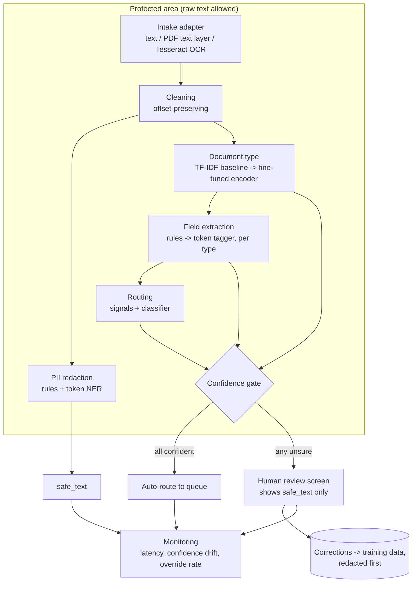

# TriageGuard architecture

This document describes how TriageGuard is put together: the runtime system we are building (M3-M5) and the data pipeline that already exists (M2). It says what is built today and what is still planned. For the history of decisions and what was redone, see [PLAN.md](PLAN.md).

## 1. What the system does

One document in, one triage decision out:

```
input: claim document (text, text-layer PDF, or scan image)
output: {
  safe_text:     text with identifiers replaced by [NAME], [SSN], ...
  doc_type:      one of 6 types + confidence
  fields:        key fields for that type (+ confidence per field)
  route:         routine | high_value | suspicious + confidence + signals
  needs_review:  true when any confidence is below its threshold
}
```

## 2. Runtime architecture (M3-M5, planned)



### Components

| Component | Responsibility | Baseline | Stronger model | Built? |
|---|---|---|---|---|
| Intake adapter | Turn any input into plain text | Read text or PDF text layer | Tesseract OCR for images | OCR path exists as a test-set script (`scripts/make_scans.py`) |
| Cleaning | Normalise characters without changing offsets | `triageguard/data/clean.py` | | Yes |
| PII redaction | Find and mask Tier 1 identifiers | Regex + word lists (Presidio-style) | Token-level NER (BERT-style) | M3 |
| Document type | Classify into 6 types with probability | TF-IDF + logistic regression | Small fine-tuned encoder | M3 |
| Field extraction | Pull type-specific fields | Rules and patterns per layout family | Token tagger trained on field spans | M3 |
| Routing | routine / high_value / suspicious | Rules over extracted fields | Classifier over fields + text | M3 |
| Confidence gate | Send unsure cases to humans | Fixed thresholds | Thresholds chosen on val, calibrated (ECE at most 0.05) | M4 |
| Service | API around the pipeline | FastAPI + Docker, `/triage`, `/health` | | M5 |
| Model registry | Versioned models, champion/challenger | MLflow (planned in M1) | | M5 |
| Monitoring | Quality and drift without raw PII | Structured logs of safe outputs | Dashboards, override rate | M5 |

### Privacy boundary (two tiers)

* **Tier 1, direct identifiers** (the 9 labels in `triageguard/schema.py`): always masked in `safe_text`. They never leave the protected area.
* **Tier 2, working facts** (service dates, amounts, codes): used inside the protected area for fields and routing, and generalised in anything that leaves it.
* Routing runs on raw text inside the protected area, because the "service before birth" signal needs the date of birth. Only signal names leave.
* Doctor names are both a field and PII. The field is used inside, and outside it shows as `[NAME]`.
* Logs, stored outputs and reviewer screens use `safe_text` only.

### Fallbacks (M1 section 14)

1. Low confidence goes to a human.
2. A model that fails or is too slow falls back to the rule baseline.
3. A bad release is rolled back by pointing the registry at the previous version.

## 3. Data architecture (M2, built)

Two fact sources feed one shared document pipeline. That is why the two corpora are comparable: they differ only in their facts.

```mermaid
flowchart LR
    subgraph Sources
        S1[In-house generator<br/>patients.py + vocab.py]
        S2[Synthea CSV + Faker<br/>synthea_source.py]
    end
    S1 --> EP[Patient + Episode objects<br/>identifiers, diagnosis, procedures,<br/>dates, line items, labs, medicines]
    S2 --> EP
    EP --> INJ[Warning-sign injection<br/>mismatch / duplicate / impossible dates<br/>+ ambiguous amount band]
    INJ --> LAY[Layouts x 6 types x 4<br/>layouts.py via span-aware DocBuilder]
    LAY --> NZ[Literal noise<br/>typos, abbreviations, line breaks, dropped lines]
    NZ --> OCR[OCR-style confusions<br/>hard set only, length-preserving]
    OCR --> LBL[Labels<br/>PII spans, fields + spans,<br/>route from visible facts]
    LBL --> VAL{validate.py<br/>spans, labels, leakage}
    VAL --> SPL[Patient-level splits<br/>train / val / test_golden / test_hard]
    SPL --> C1[(data/corpus)]
    SPL --> C2[(data/corpus_synthea)<br/>main dataset]
    C1 & C2 --> RO[make_scans.py<br/>render + Tesseract -> real_ocr.jsonl]
```

### Key design rules

| Rule | Why | Where |
|---|---|---|
| Every labelled value is emitted through `DocBuilder` | Character offsets are exact, so PII and field labels are exact | `builder.py` |
| Noise touches only text between labelled values | Spans never drift | `noise.py` |
| OCR-style corruption swaps characters one for one | Spans stay valid on OCR-like text | `noise.ocr_corrupt` |
| Routing labels use only facts the document shows | A label must be recoverable from the text | `routing.py`, `layouts.py` (`shown`) |
| Splits are by patient; layout 3 of each type appears only in `test_hard` | No patient or template leakage | `generate.py`, `validate.py` |
| Generation fails on any validation error | Bad labels never reach a model | `validate.py` |
| Deterministic for a given seed | Anyone can reproduce the corpus | `generate.py` |

### Dataset roles

| Dataset | Role |
|---|---|
| `data/corpus_synthea/` (Synthea + Faker) | **Main dataset** for M3 onward: more realistic facts, see [realism_comparison.md](realism_comparison.md) |
| `data/corpus/` (in-house) | Balanced, privacy-safe control set. Also used to test whether models trained on one source transfer to the other |
| `*/test_golden.jsonl` | Frozen final score. Never tuned on |
| `*/test_hard.jsonl` | Held-out layouts, heavy noise, simulated OCR. Reported next to golden |
| `*/real_ocr.jsonl` | 150 golden docs through real Tesseract. Spans do not align, so PII is scored by string search |

### Record format

One JSON object per line with the text, PII spans, fields with values and spans, route, signals and provenance (patient, episode, layout, noise, OCR). Full example in [data_card.md](data_card.md#record-format-jsonl-one-document-per-line).

## 4. Code map

```
triageguard/
  schema.py              shared label sets (PII labels, doc types, fields per type, routes)
  data/
    vocab.py             in-house word lists
    patients.py          in-house Patient / Episode generation
    synthea_source.py    Synthea CSV -> Patient / Episode, Faker identifiers
    builder.py           span-aware text builder, surface formats
    layouts.py           6 types x 4 layouts; returns visible facts for routing
    noise.py             literal noise, OCR-style confusions
    routing.py           multi-signal route labels
    clean.py             offset-preserving cleaning (also used at runtime)
    validate.py          integrity and leakage checks
    generate.py          corpus assembly, splits, manifests (both sources)
  (M3+) redaction/, classify/, extract/, route/, gate/, api/
scripts/
  generate_corpus.py, generate_synthea_corpus.py, make_scans.py, eda.py, compare_realism.py
tests/                   unit tests (python3 -m unittest)
docs/                    M1 PDF, ARCHITECTURE, PLAN, data card, EDA, privacy, realism, decision log
reports/                 machine-readable statistics
tools/                   (git-ignored) Synthea jar and raw output
```

## 5. Environment

| Need | Used for | Where |
|---|---|---|
| Python 3.10+ standard library | In-house corpus, EDA, tests | system Python |
| `.venv` with Faker, Pillow (`requirements.txt`) | Synthea + Faker corpus, scan rendering, realism report | project venv |
| Java 17+ and the Synthea jar | Re-running Synthea | `tools/synthea/` |
| Tesseract 5 | Real OCR sets, later the intake adapter | Homebrew |
| (M3) scikit-learn, PyTorch, Transformers, MLflow | Models and experiment tracking | project venv, GPU via Colab/Kaggle if needed |
